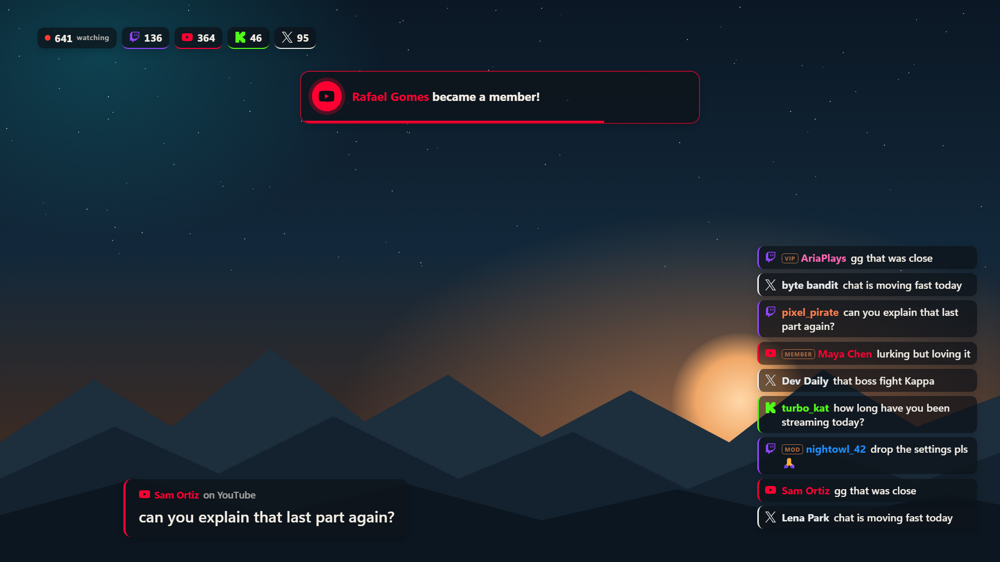
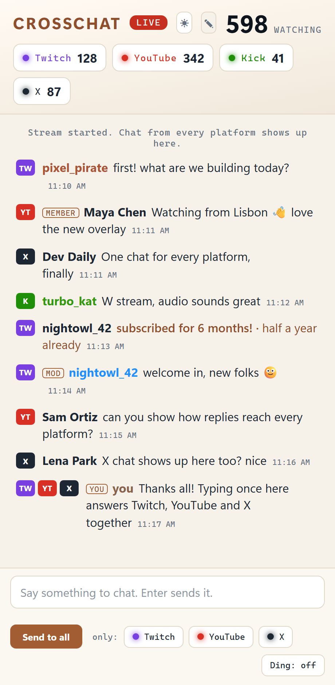
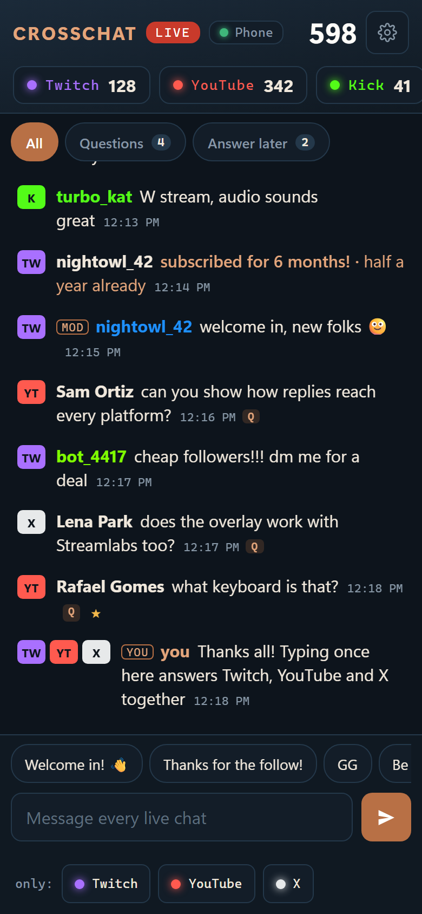
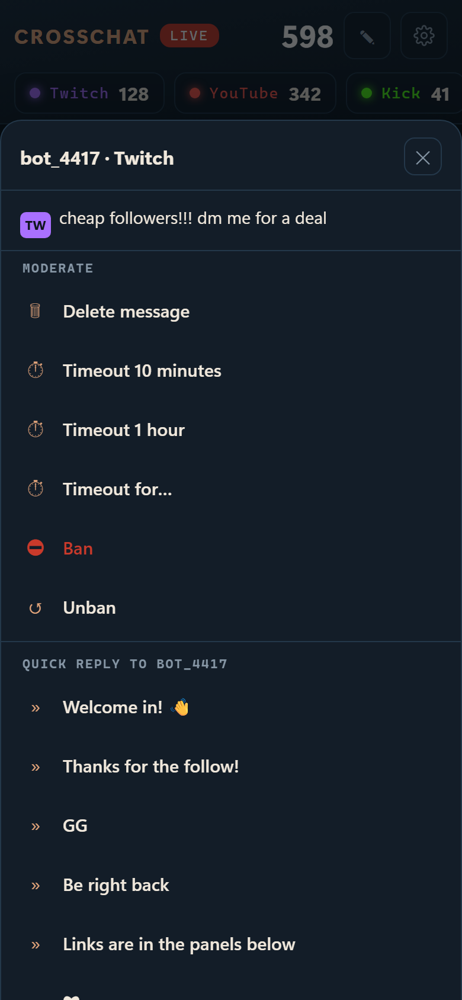
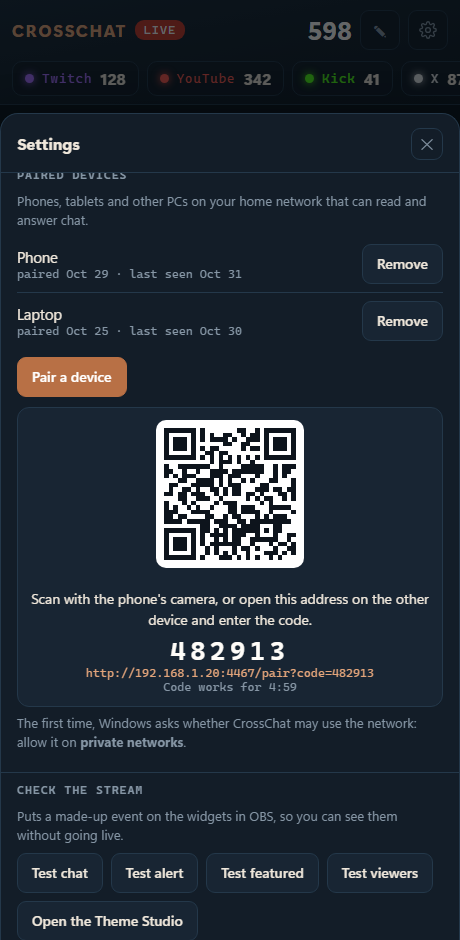
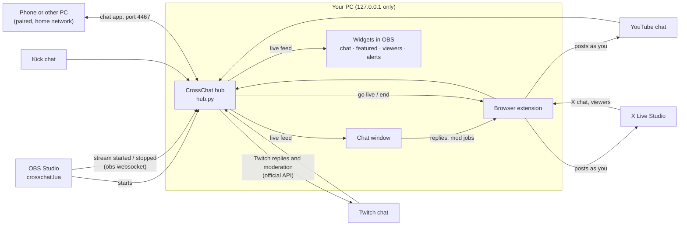

<p align="center">
  
</p>

<p align="center">
  <a href="https://github.com/RandyNorthrup/crosschat-obs/releases/latest"></a>
  <a href="https://github.com/RandyNorthrup/crosschat-obs/releases"></a>
  <a href="https://github.com/RandyNorthrup/crosschat-obs/actions/workflows/ci.yml"></a>
  
  
  <a href="LICENSE"></a>
  <a href="https://github.com/sponsors/RandyNorthrup"></a>
  <a href="https://www.paypal.com/donate/?hosted_button_id=Q9VC7B42R7K82"></a>
</p>

**CrossChat** is a free companion for OBS Studio when you stream to several platforms at once. It reads **Twitch, YouTube, Kick and X** chat into one window, lets you **answer everyone with one message** (or one person on their own platform), **moderates** Twitch and YouTube, puts **themeable chat, featured messages, viewer counts and alerts** on your stream, and **starts and ends your X livestream together with OBS**. Pair your **phone or another PC** to read, answer and moderate chat from there. Everything runs on your own PC and home network.

<table>
  <tr>
    <td width="68%"></td>
    <td width="32%"></td>
  </tr>
  <tr>
    <td align="center"><sub>What viewers see. Rendered by OBS 33.0.1 with all four widgets.</sub></td>
    <td align="center"><sub>What you see: the CrossChat window.</sub></td>
  </tr>
</table>

## Features

**One chat window for every platform**
- Twitch, YouTube, Kick and X chat in one list, each line tagged with where it came from.
- Viewer counts per platform and in total.
- Subs, raids, cheers, Super Chats and memberships are marked in the list.
- Deleted messages and timed-out viewers are struck through.
- Light, dark, or follows Windows.
- Opens by itself when OBS starts streaming, and closes two minutes after you stop.

**Reply and moderate from one place**
- Type once to post to every live platform, as you.
- Use **only:** to post to a single platform, or open a message and press **reply** to answer that person on their own platform. On Twitch that's a threaded reply.
- **Quick replies:** one-tap lines and emoji you edit yourself.
- **Moderation:** delete a message, time out or ban, on Twitch and YouTube.
- **Answer later:** star messages to come back to. Questions are picked out for you.
- **Twitch through Twitch's official API.** Connect once in Settings; the code is pre-filled at twitch.tv/activate.
- YouTube and X go out through your signed-in browser and the CrossChat extension.
- Test mode (`?dry`) walks through the whole path without posting anything.

**Companion on your phone or another PC**
- Pair with a QR code. The full chat app then runs on any phone, tablet or PC on your home network, with no install and no logins on that device.
- Read, reply, use quick replies, moderate, star, put messages on stream, and send test alerts.
- Only paired devices get in, and you can remove one at any time. See **[docs/COMPANION.md](docs/COMPANION.md)**.

**Four on-stream widgets** (OBS Browser Sources)
- **Chat feed**: the merged chat, or only the platforms you choose.
- **Featured message**: hover any message in the CrossChat window, press **show**, and it appears big on stream.
- **Viewer counter**: everyone watching, in total and per platform.
- **Alerts**: subs, resubs, gifts, raids, cheers, memberships and Super Chats, with an optional chime.

**Theme Studio**
- Eight built-in looks, and full control over fonts, colours, layout, animation, platform icons and custom CSS.
- Live preview over your own screenshot, and one-click test events to the sources already in OBS.
- A different theme per scene.

**X Live started with OBS**
- X only goes live when you press Go Live on its Live Studio page. The CrossChat browser extension does that for you when OBS starts streaming, and ends the livestream when you stop.
- X's chat and viewer count join the CrossChat window.

**Follows OBS, stays local**
- The OBS script starts CrossChat with OBS and stops it when OBS closes.
- CrossChat reads its OBS WebSocket settings from OBS itself, and portable OBS works too.
- No account, server, telemetry or update checks.

## Screenshots

| Light or dark, follows Windows | Replying to one person, with a message featured on stream |
|---|---|
|  |  |

| Companion on a phone | Moderation and quick replies | Pairing a device |
|:-:|:-:|:-:|
|  |  |  |

**Theme Studio:** change any part of the look and watch all four widgets update over a stream-sized preview.


**Inside OBS 33.0.1:** the four widgets added as Browser Sources.


### Built-in themes

| Classic | Minimal outline | Glass | Bubbles |
|:-:|:-:|:-:|:-:|
|  |  |  |  |
| **Compact** | **Neon** | **Paper** | **High contrast** |
|  |  |  |  |

Every setting, the CSS hooks and how to share themes are in **[docs/THEMES.md](docs/THEMES.md)**.

## What you need

| | |
|---|---|
| **PC** | Windows 10 or 11, 64-bit (tested on Windows 11) |
| **OBS Studio** | 28 or newer, with its built-in WebSocket server. Tested with **33.0.1** (obs-websocket 5.7.6). |
| **Browser** | Google Chrome, or Microsoft Edge. Needed only for replying and for X. |
| **Python** | 3.10 or newer. If you don't have it, the installer offers to install it. |
| **X Live** *(optional)* | X Premium with access to [X Live Studio](https://studio.x.com/live), and OBS sending video to X (see [X Live](#x-live)). |

CrossChat doesn't send your video anywhere. OBS does that. To stream to several platforms at once, use what you already use for that: an OBS multi-output plugin such as [obs-multi-rtmp](https://github.com/sorayuki/obs-multi-rtmp), or a restreaming service.

## Install

1. **Download** `CrossChat-<version>-windows.zip` from **[Releases](https://github.com/RandyNorthrup/crosschat-obs/releases/latest)** and extract it anywhere.
2. **Double-click `Install.cmd`.** It does the following:
   - finds Python 3.10+, or offers to install it;
   - copies CrossChat to `%LOCALAPPDATA%\CrossChat`;
   - sets up its own Python environment;
   - asks for your Twitch, YouTube and Kick channels and whether you stream to X;
   - turns on OBS's WebSocket server if it's off;
   - adds a **CrossChat** folder to the Start menu.

   Running it again later updates CrossChat and keeps your settings and themes.
3. **Add the script to OBS:** *Tools → Scripts → +*, then pick `%LOCALAPPDATA%\CrossChat\obs\crosschat.lua`. The installer puts this path on your clipboard.
4. **Add the extension** to Chrome or Edge:
   1. Open `chrome://extensions` (or `edge://extensions`).
   2. Switch on **Developer mode**.
   3. Press **Load unpacked** and pick `%LOCALAPPDATA%\CrossChat\extension`.

   Reading chat and the on-stream widgets work without the extension. Replying and X Live need it.
5. **Add the widgets you want** to your scenes as Browser Sources:

   | Widget | URL | Size |
   |---|---|---|
   | Chat feed | `http://127.0.0.1:4466/overlay/chat` | 450 × 800 |
   | Featured message | `http://127.0.0.1:4466/overlay/featured` | 900 × 260 |
   | Viewer counter | `http://127.0.0.1:4466/overlay/viewers` | 600 × 120 |
   | Alerts | `http://127.0.0.1:4466/overlay/alerts` | 800 × 300 |

   Add `?theme=neon` (or any theme name) to give one source its own look. The Theme Studio's **Copy OBS address** buttons build these addresses for you.

> [!TIP]
> Use the `http://127.0.0.1:4466/...` addresses rather than local files. OBS 33's browser blocks pages opened as local files from reaching anything on `127.0.0.1`.

To check everything without going live, press **Send test to OBS** in the Theme Studio, or start OBS streaming to a test server on your own PC. CrossChat sees that a stream to `rtmp://127.0.0.1` is a test and doesn't start anything public.

## Using it

| To | Do this |
|---|---|
| Open the chat window | Start OBS streaming (it opens by itself), or Start menu → CrossChat → **Open chat**, or the OBS hotkey |
| Answer everyone | Type in the box and press **Enter** |
| Answer one platform or one person | **only:** buttons, or hover a message → **reply** |
| Put a message on stream | Hover it → **show**. **Hide** in the window, or the hotkey, takes it off. |
| Restyle the widgets | ✎ in the chat window, or Start menu → CrossChat → **Theme Studio** |
| Go live on X now | Start menu → **Go live on X**, the OBS script's button, or the hotkey |
| Moderate | Open a message → **Moderate** (Twitch needs **Connect Twitch** in Settings once) |
| Use your phone or another PC | Settings (⚙) → **Pair a device**, then scan the QR code or type the 6-digit code on that device |

**Hotkeys** (OBS → *Settings → Hotkeys*, search "CrossChat"):
- Open chat window
- Go live on X
- Hide featured message

A Stream Deck can trigger them with a *Hotkey* action, or open the Start-menu shortcuts with *System → Open*.

**The OBS script panel** (*Tools → Scripts → crosschat.lua*) has buttons for all of the above, plus a dry run for X and **Start the hub again**.

### What each platform supports

| | Read chat | Reply | Moderate | Viewer count | Alerts |
|---|:-:|:-:|---|:-:|---|
| **Twitch** | ✅ | ✅ (official API once connected) | delete, timeout, ban, unban | ✅ | subs, resubs, gifts, raids, cheers |
| **YouTube** | ✅ | ✅ | remove, 5-minute timeout, hide user | ✅ | Super Chats, Super Stickers, members, gifted memberships |
| **Kick** | ✅ | — | — | ✅ | subs, gifts, hosts (see [Known limits](#known-limits)) |
| **X** | ✅ | ✅ | — | ✅ | — |

## X Live

X has no stream key that starts a livestream by itself: someone has to press **Go Live** on X Live Studio. CrossChat does it for you.

1. In [X Live Studio](https://studio.x.com/live), create a source (CrossChat expects it to be called **OBS**; change `x.source` if yours has another name) and send OBS's video to it with your multistream setup.
2. Run `Install.cmd` and answer **yes** to "Do you stream to X?", or set `"x": {"enabled": true}` in `config.json`.
3. When OBS starts streaming, CrossChat waits a few seconds, opens Live Studio next to the chat window, and the extension:
   - checks the source shows **Connected**;
   - fills in the title;
   - sets the audience to **Public**;
   - presses **Go Live**.

   A banner at the top of the X page shows each step. The chat window says **X: live.**, or where it stopped.
4. When OBS stops, the X livestream is ended about 15 seconds later, so a quick stop and start in OBS doesn't end it.

The extension only acts in the two minutes after the hub asks it to, so opening or reloading the X page yourself never starts a stream. To rehearse:
- **Test X (never goes live)** fills in the form without pressing Go Live.
- `hub\control.py x-private` (in the CrossChat folder) goes live visible to you only.

Turn off the automatic start with `"auto_go_live": false` and use **Go live on X** when you want it.

## Settings

Your settings are in `%LOCALAPPDATA%\CrossChat\config.json` (start from [`config.example.json`](config.example.json)). Restart OBS after changing them.

| Key | Default | |
|---|---|---|
| `twitch`, `youtube`, `kick` | `""` | Your channels. A name, an `@handle`, a channel ID or a link all work. |
| `port` | `4466` | The hub's port on `127.0.0.1`. The extension expects 4466. |
| `browser` | `"auto"` | `"auto"` (Chrome, else Edge), `"chrome"`, `"edge"` or a full path. It must be the browser that has the extension. |
| `window` | `"auto"` | `"auto"` docks the chat at the right edge of the main screen, or `{"x", "y", "width", "height"}`. Put it where OBS doesn't capture. |
| `open_window_on_stream_start` | `true` | Open the chat window when OBS starts streaming. |
| `close_window_seconds_after_stream` | `120` | How long it stays after the stream ends. |
| `overlay.platforms` | `"all"` | Which platforms the on-stream chat shows by default, for example `["twitch"]`. |
| `overlay.theme` | `"classic"` | The theme sources use without `?theme=` (the Theme Studio's **Set as default** overrides it). |
| `obs.host`, `obs.port`, `obs.password` | from OBS | Only if OBS's WebSocket isn't on this PC or you want to override what OBS has saved. |
| `remote.enabled`, `remote.port` | `true`, `4467` | The companion for paired devices. It only starts listening once you pair a device. |
| `twitch_client_id` | CrossChat's | Use your own Twitch app instead (a Public client from dev.twitch.tv). |
| `x.enabled` | `false` | Use X Live. |
| `x.auto_go_live` | `true` | Go live on X when OBS starts streaming. |
| `x.title` | `"Live now"` | Livestream title. |
| `x.title_file`, `x.title_prefix` | `""` | Use the first line of a text file as the title instead (handy with a "now building" file). |
| `x.source` | `"OBS"` | The source name in X Live Studio. |
| `x.end_with_obs` | `true` | End the X livestream when OBS stops. |

## How it works



When you pair a device, Windows asks once whether Python may use the network. Choose **Allow** for private networks.

- **The hub** (`hub/hub.py`) is a small Python program. It reads each platform's public chat and follows OBS through its WebSocket server. It serves the chat window, the widgets and the Theme Studio, on `127.0.0.1` only.
- **The OBS script** (`obs/crosschat.lua`) starts the hub with OBS and gives you buttons and hotkeys.
- **The extension** (`extension/`) does what only your signed-in browser can do: post your replies, and work X Live Studio.

## Privacy and security

- Everything stays on your PC. The hub listens on `127.0.0.1` only and answers only under that address.
- Anything that *does* something (opening windows, going live, featuring a message, changing themes) is refused when another website asks for it.
- Reading chat uses the platforms' public, signed-out chat feeds.
- **Twitch replies and moderation** use Twitch's official API once you connect Twitch.
  - CrossChat asks for three permissions only: write chat, delete messages, ban/unban.
  - The token is encrypted for your Windows account (DPAPI). Disconnecting revokes it at Twitch.
  - Before you connect, the extension posts Twitch replies using your browser's Twitch login cookie, for that one connection only.
- YouTube and X replies, and YouTube moderation, go out from your own browser with the accounts already signed in there.
- **The companion port (4467)** only opens after you pair a device.
  - It answers paired devices only: an HttpOnly cookie per device, of which only a hash is stored.
  - Pairing codes are 6 digits, last 5 minutes and allow 5 tries.
  - Use it on your home network only.
- CrossChat reads OBS's WebSocket password from OBS's own settings file. It doesn't copy it anywhere.
- No telemetry, no analytics, no update checks. The only log is `%LOCALAPPDATA%\CrossChat\crosschat.log`.

More detail, and how to report a problem privately: [SECURITY.md](SECURITY.md).

## Troubleshooting

| Problem | What to check |
|---|---|
| A message box says CrossChat can't reach OBS's WebSocket server | OBS → *Tools → WebSocket Server Settings* → tick **Enable WebSocket server**. CrossChat connects by itself once it's on. |
| Widgets show nothing | Is OBS open with `crosschat.lua` loaded? Press **Start the hub again** in *Tools → Scripts*. Use the `http://127.0.0.1:4466/...` address, not a local file. |
| "Replies go out through the CrossChat extension, and it is not active" | Load the extension (Install step 4), then close the chat window and open it again. |
| A reply to one platform failed | The chat window says why (not signed in, message too long, chat not open). YouTube replies need you signed in to YouTube in the same browser. |
| X stopped at a step | The X page banner and the chat window name the step. Finish by hand; if it keeps happening, X may have changed its page, so [open an issue](https://github.com/RandyNorthrup/crosschat-obs/issues). |
| Anything else | `%LOCALAPPDATA%\CrossChat\crosschat.log`, and the OBS log (*Help → Log Files*, lines with `crosschat.lua`). |

## Known limits

- **Windows only.** The hub uses Windows to place and close the chat window.
- **Kick replies** aren't supported. Kick alerts come from Kick's public feed and haven't been checked against a real Kick stream yet.
- **X Live** depends on X Live Studio's page and needs X Premium. CrossChat clicks through it like a person would, so a redesign by X can break it until CrossChat is updated.
- **YouTube** chat is read the same way YouTube's own chat pop-out reads it.
- **YouTube moderation** clicks through YouTube's own chat menu in the CrossChat window, so the signed-in account must own the channel or moderate it. It hasn't been checked against a live YouTube stream yet.
- **Twitch moderation and replies** use Twitch's documented API. Sign-in and token handling were verified against Twitch. The individual ban, delete and post calls are covered by tests, not by real moderation on a live channel.
- **The companion** uses plain `http` on your home network, like a router's own page. Don't forward its port. For away-from-home use, see Tailscale in [docs/COMPANION.md](docs/COMPANION.md).
- **Twitch's simulcasting guidelines** have restricted showing other platforms' chat on a Twitch stream. Check the current rules. `"overlay": {"platforms": ["twitch"]}` (or `?platforms=twitch` on one source) shows Twitch chat only.

## Uninstall

Start menu → CrossChat → **Uninstall CrossChat**. It offers to keep your settings and themes in `Documents\CrossChat backup`.

Then remove the two pieces it can't:
- the script in OBS (*Tools → Scripts*, select it, **−**);
- the extension in your browser.

## Development

```powershell
python -m pip install -r hub/requirements.txt pytest ruff
python hub/hub.py --test --twitch <any live channel>     # run the hub without OBS, against real chat
ruff check hub scripts tests
python -m pytest                                         # 42 tests: config, platforms, web server, obs-websocket, companion
node --test "tests/js/*.test.mjs"                        # 24 tests: theme engine, chat app
python scripts/obs_e2e.py --obs <portable OBS folder>    # end to end against a real OBS (see the file)
pwsh scripts/package.ps1                                 # builds dist\CrossChat-<version>-windows.zip
```

`scripts/obs_e2e.py` sets up a throwaway portable OBS with the script and the four widgets. It streams to an RTMP receiver on your PC (ffmpeg) and checks 19 things, from the script starting the hub to the hub leaving when OBS closes. It never touches your own OBS. Version 1.0.0 passed all 19 on OBS 33.0.1.

## Credits

- Platform icons: [Simple Icons](https://simpleicons.org) (CC0). The platform names and logos belong to their owners.
- See [THIRD_PARTY_NOTICES.md](THIRD_PARTY_NOTICES.md).

CrossChat isn't affiliated with or endorsed by OBS Project, X Corp., Twitch, YouTube or Kick.

## License

[MIT](LICENSE) © 2026 Randy Northrup
