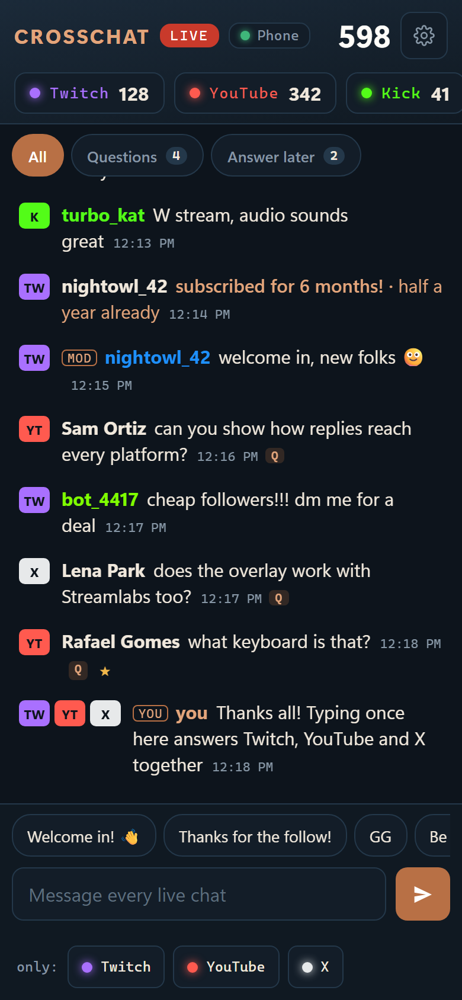
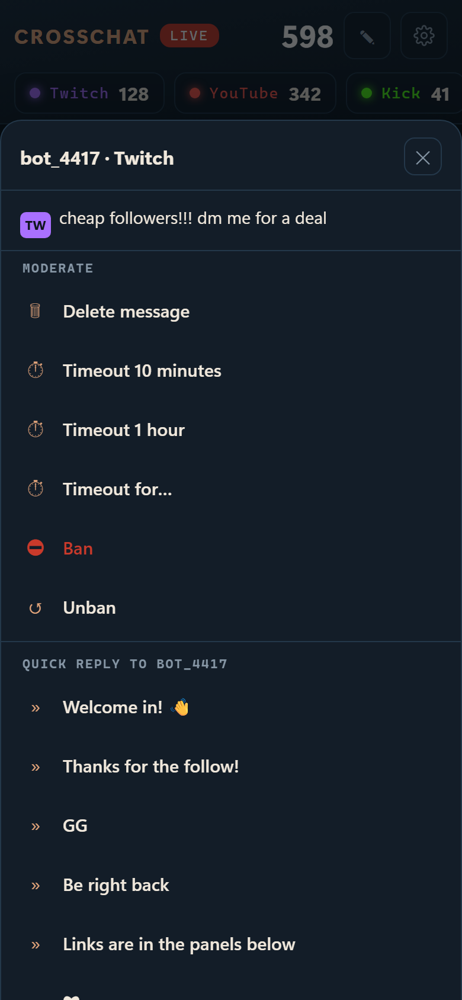
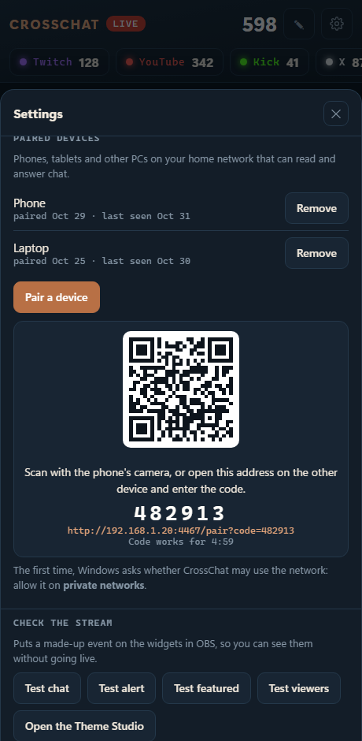
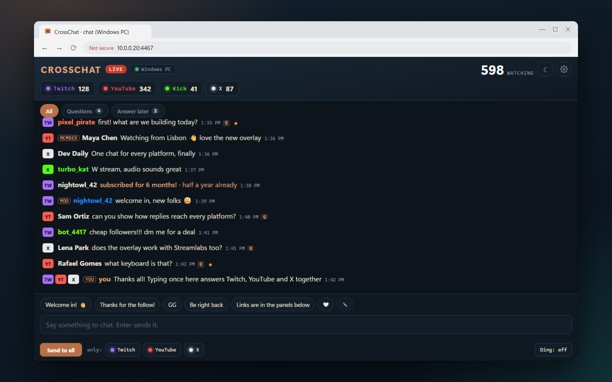

# The companion: chat on your phone or another PC

The CrossChat window on your streaming PC can also be opened on a **phone, tablet or second PC** on your home network. You get the same live chat with viewer counts. From there you can:

- reply to everyone, to one platform or to one person;
- send quick replies;
- show a message on stream;
- star messages to answer later;
- have a message read aloud on the streaming PC;
- moderate.

Nothing is installed on the other device: it's a web page, and you can add it to the home screen like an app.

  
  

## Pair a device

1. On the streaming PC, open the CrossChat window and press the **gear** (Settings) → **Pair a device**.
2. A QR code, a 6-digit code and an address appear. The code works for **5 minutes**.
3. On the phone, scan the QR code with the camera. On another PC, type the address into its browser. Either way the device is paired and opens the chat.
4. The first time, Windows asks whether CrossChat may use the network. Choose **Allow** for **private networks**.

**Add it to the home screen**, so it opens like an app:
- iPhone and iPad: Safari → **Share** → **Add to Home Screen**.
- Android: Chrome menu → **Add to Home screen** (or **Install app**).

Each paired device is listed under **Settings → Paired devices** on the streaming PC, with the day it was paired and when it was last seen. **Remove** takes its access away at once; pair it again to bring it back.

## From another PC

A second PC works the same way as a phone, in any modern browser. It's handy for a moderator's PC, a laptop beside you, or the PC you game on while another one streams.

1. On the streaming PC: **Settings → Pair a device**. Note the address, for example `http://192.168.1.20:4467/pair?code=123456`.
2. On the other PC, open that address in Chrome, Edge or Firefox. If you typed only the address without `?code=…`, enter the 6-digit code when asked. The page then becomes the full chat app, and the browser remembers the pairing.
3. Later, just open `http://<streaming PC address>:4467/` again. Bookmark it.
4. For a window of its own with a taskbar icon:
   - **Chrome**: **⋮ → Cast, save and share → Create shortcut… →** tick **Open as window**.
   - **Edge**: **⋯ → Apps → Install this site as an app**.

## What works when

The companion talks to the CrossChat hub on the streaming PC, so that PC must be on, with OBS (and so the hub) running.

| | Needs |
|---|---|
| Reading chat, viewer counts, live status | The hub running (it starts with OBS) |
| Show on stream, Answer later, quick-reply editing, test events | The hub running |
| Replies and moderation on **Twitch** | **Twitch connected** in Settings on the streaming PC |
| Replies and moderation on **Kick** | **Kick connected** in Settings on the streaming PC |
| Replies and moderation on **YouTube**, replies on **X** | The **CrossChat window open on the streaming PC**, in Chrome or Edge with the CrossChat extension. It opens by itself when you go live. |
| **Read aloud** | The CrossChat window open on the streaming PC, in Chrome or Edge (the copy docked inside OBS doesn't speak). It reads through that PC's speakers. |
| Text-to-speech settings, filters, chat history | Only on the streaming PC (Settings there) |

When something isn't available, the companion says why: in the bar under the header, next to the action (greyed out with a reason), or in the chat list after you try.

## Using it

- **Tap a message** (or click **⋯**, right-click, or select it and press Enter) to see what you can do with it:
  - **Reply**: answers that person on their own platform. On Twitch it's a threaded reply.
  - **Show on stream / Hide from stream**: puts it in the featured-message widget.
  - **Answer later**: stars it.
  - **Read aloud**: reads it on the streaming PC's speakers.
  - **Copy text**.
  - **View viewer**: their card (see below).
  - **Filter this user** (streaming PC only): hides everything they write, here and on stream. Press it again on one of their messages to stop.
  - **Moderate**: see below.
  - **Quick reply to *name***: one of your quick replies, sent to that person.
- **Marks in the list:**
  - **NEW** (green): a viewer's first message in your channel ever (Twitch says when). **1ST**: their first message this stream.
  - **Dimmed, with "hidden · word"** (or viewer, command, bot): your filters hid it. It isn't on stream and isn't read aloud.
- **Mouse:** hovering a message shows **reply**, **show**, **☆** and **⋯**.
- **Keyboard:**
  - **↑ ↓** move between messages, and **Enter** opens the actions;
  - **r** replies, and **s** stars;
  - **Esc** cancels a reply.
- **The box** sends to every live chat that takes replies. Use **only:** to send to one platform. The counter warns when a message is too long for a platform: X takes 140 characters, YouTube 200, Twitch and Kick 500.

### Viewer cards

**Tap or click a name** (or **View viewer** in a message's actions) to see that viewer:
- their first message this stream, and whether it was their first ever in your channel;
- how many messages they sent this stream, and in how many earlier streams they chatted;
- everything they wrote this stream and in earlier streams (from the chat history on the streaming PC), newest first, with a search box;
- **Read aloud last message**, **Filter this user** (streaming PC only) and the same **Moderate** choices as on a message, for their latest message.

The card shows the newest 200 lines of each; search to find older ones.

### Alerts

Subs, resubs, gifts, raids, cheers, Super Chats, Super Stickers, memberships and Rumble Rants look the same in the chat list whichever platform they come from: a tag with the kind (**GIFT**, **RANT**…), one sentence with the name and the amount, then what the viewer wrote. The widgets in OBS use the same sentences, which you can change in the Theme Studio.

### Quick replies

The row above the box holds your quick replies.
- **Tap** one to send it to every live chat at once.
- **Hold** it (or right-click it) to put it in the box first, to add to it.
- **✎** opens the editor: add, reorder or remove replies. You can have up to 30, each up to 100 characters.

The list is kept by the hub, so every device and the streaming PC share it.

### Questions and Answer later

- **Questions** shows only messages that ask something. CrossChat spots them by itself, and they're marked **Q** in the list.
- **Answer later** shows the messages you starred. Starred messages stay in the list even when chat moves fast. Stars are shared between all your devices, so you can star on the phone and answer from the PC.

### Moderation

| | Delete a message | Timeout | Ban |
|---|---|---|---|
| **Twitch** (Twitch connected) | ✓ | 10 minutes, 1 hour, or any length up to 14 days | ✓ (and unban) |
| **Kick** (Kick connected) | ✓ | 10 minutes, 1 hour, or any length up to 7 days, in whole minutes | ✓ (and unban) |
| **YouTube** (CrossChat window open on the streaming PC) | ✓ (remove) | 5 minutes (YouTube's fixed length) | Hide user on this channel |
| **X** | — | — | — |

- A ban always asks first.
- On YouTube, CrossChat uses YouTube's own chat menu in the CrossChat window on the streaming PC. The YouTube account signed in there must own the channel or be a moderator.
- **Connect Twitch** (needed to reply on Twitch, too):
  1. On the streaming PC: Settings → Connections → **Connect Twitch**.
  2. Go to **twitch.tv/activate** and enter the code shown, signed in as the streamer or a moderator.
  3. After that, Twitch replies and moderation work from every device.
- **Connect Kick:**
  1. On the streaming PC: Settings → Connections → **Connect Kick**.
  2. A kick.com tab opens. Sign in as the streamer and approve CrossChat.
  3. After that, Kick replies and moderation work from every device.

## Read aloud, filters and chat history

These are set up on the streaming PC, in Settings there.

- **Text to speech** reads chat through the streaming PC's speakers: every message, questions only, events (subs, raids…), messages that start with a command such as `!tts`, or just the message you show on stream. Pick the voice, speed and volume, whether to say who wrote it, and whether to skip links. **Test the voice** tries it; **Stop reading** (also on the companion, and in the bar above the box while it reads) stops and skips what's waiting.
  - Voices listed **On this PC** stay on the PC. Voices listed **Online** (Edge's "Natural" voices, Chrome's Google voices) send the text they read to Microsoft or Google to make the audio; Settings says so when you pick one. CrossChat never picks an online voice by itself.
  - Lines are read one at a time, never over each other. Hidden messages are never read.
- **Filters** hide messages by word or phrase, by viewer (name or @handle), `!commands`, and known chat bots. Hidden messages never reach the widgets in OBS; in the chat list they stay, dimmed, with why.
- **Chat history**: every stream's chat is saved on the streaming PC. Settings → **Open chat history** lists your streams, newest first. Open one to search it by name or words, show one platform or questions only, and **Export** it as a spreadsheet (CSV) or a web page (HTML).
- **Connections** shows how each chat is doing: how long it has been connected, when the last message came and how often it reconnected. The same line is in the tooltip of each platform pill at the top.

## Settings

| | |
|---|---|
| **Channels & options** | Your Twitch, YouTube, Kick and TikTok channels, Facebook and X on or off, X's title, the window, emotes, chat history and the companion, each with a line on what it does (on the streaming PC). **Save** checks every value and says which changes wait for OBS to restart. The first time CrossChat runs without any channel, Settings opens here. |
| **Look and sound** | Auto (follows the device), Light or Dark; a ding when a message arrives. Each device remembers its own. |
| **Text to speech** | What to read, voice, speed, volume (on the streaming PC). **Stop reading** works from any device. |
| **Filters** | Words, viewers, `!commands`, bots (on the streaming PC). |
| **Connections** | Each chat's health; connect or disconnect Twitch, Kick, Rumble and Discord (on the streaming PC). |
| **Paired devices** | The list, **Remove**, **Pair a device**, and the Tailscale switch for away from home (on the streaming PC). |
| **Chat history** | Saved chat of every stream: search and export (on the streaming PC). |
| **Check the stream** | Test chat, alert, featured message or viewer count on the widgets in OBS, without going live. |
| **About** | The version, and on the streaming PC the address other devices use and the update notice switch (off by default). |

## Keeping it private

- **Paired devices only.**
  - Each paired device has its own key, kept by its browser.
  - Without one, the companion address shows only the pairing page.
  - Pairing codes are random, 6 digits, and last 5 minutes.
- **Home network only.**
  - The companion uses plain `http` on your local network, like a printer's or router's own page.
  - Use it on a network you trust, not public or hotel Wi-Fi.
  - **Don't forward its port** on your router.
- **From away from home**, the safe way is [Tailscale](https://tailscale.com): a private, encrypted network between your own devices, free for personal use.
  1. Install Tailscale on the streaming PC and on the phone, and sign in to the same account on both.
  2. On the streaming PC: Settings → Paired devices → switch on **Away from home too, with Tailscale**. It shows the PC's Tailscale address, or says what's missing.
  3. **Pair a device** and scan the QR code. With Tailscale on, the code uses the PC's Tailscale address, so it works at home and away while Tailscale runs on the phone. A phone paired before needs pairing once more.
  - Pairing is still required. The companion listens only on the address Windows has on Tailscale's own adapter, and stops listening there when Tailscale stops.
- Removing a device in Settings takes effect immediately. The device then says it is no longer paired.

## Troubleshooting

| Problem | Try |
|---|---|
| The address doesn't load on the phone | Same Wi-Fi as the PC (not a guest network, which often keeps devices apart)? Did Windows ask about the network and get **Allow** for private networks? If not, open Windows Security → Firewall → *Allow an app through firewall* and tick **Private** for Python. |
| It worked yesterday, not today | The PC may have a new address on your network. Pair again; the new address is in the QR code and under Settings → About. |
| "This device is no longer paired" | It was removed, or its key was cleared with the browser's data. Pair it again. |
| "Needs the CrossChat window open on the streaming PC" | Open it there: Start menu → CrossChat → **Open chat** (Chrome or Edge with the extension), or go live and it opens by itself. |
| "Connect Twitch in Settings to reply on Twitch" | Twitch replies and moderation go through Twitch's official API: Settings → Connections → **Connect Twitch** on the streaming PC. The same goes for Kick. |
| Twitch says "This CrossChat has no Twitch app Client ID" | This build can't connect to Twitch's API, so Twitch chat is read only in it. |
| Nothing is read aloud | Is **Read chat aloud** on (Settings → Text to speech)? Is the CrossChat window open on the streaming PC in Chrome or Edge (not just docked in OBS)? If it says "Click anywhere in this window once", do that: browsers only speak after a click. |
