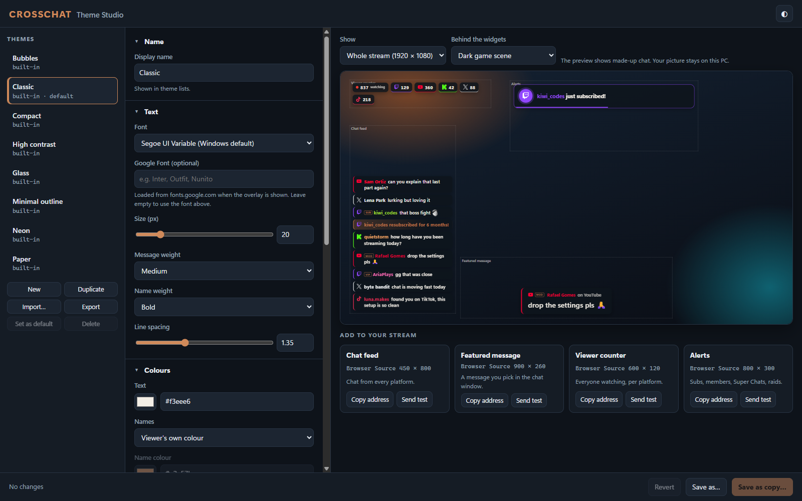
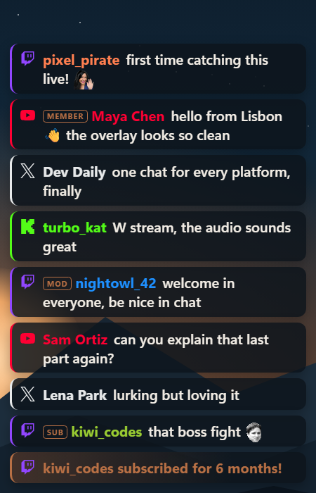
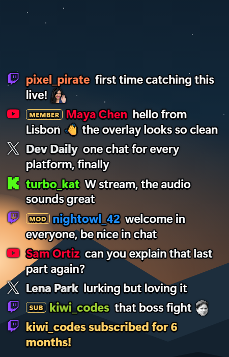
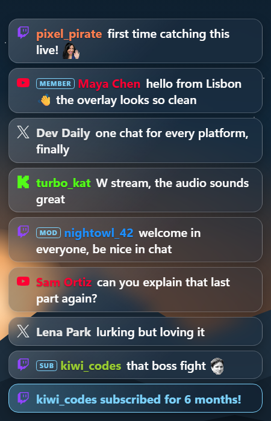
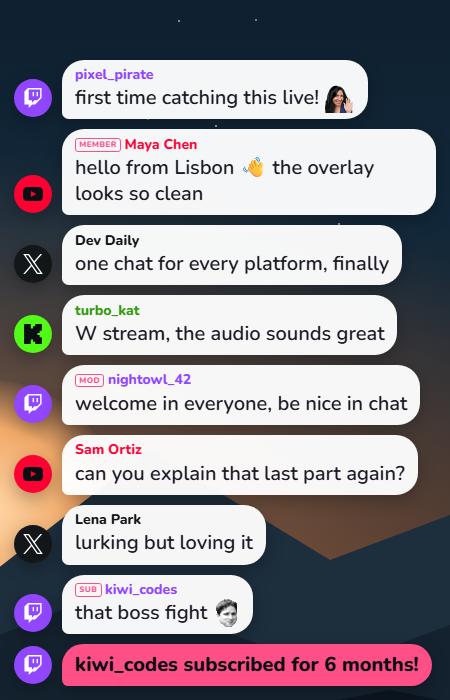
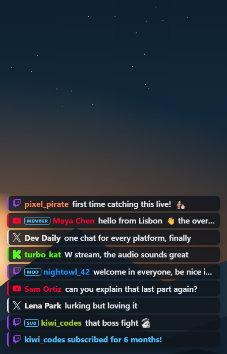
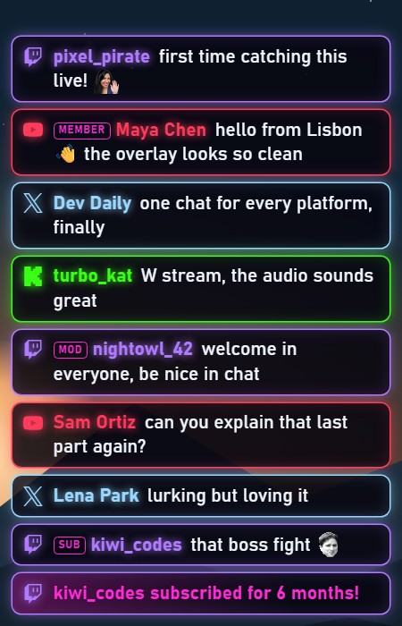
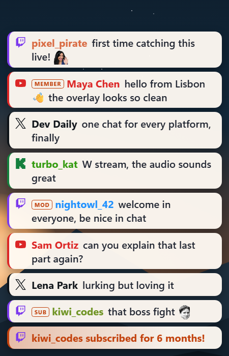
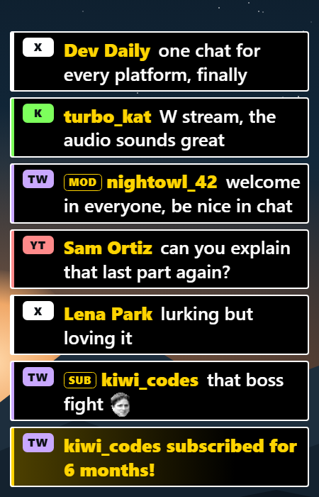
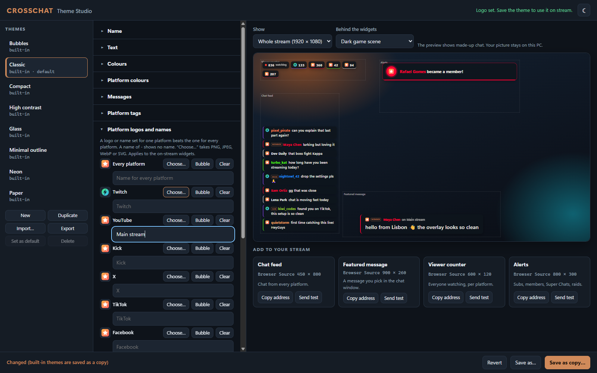

# Themes and on-stream widgets

CrossChat puts four widgets on your stream. Each one is a **Browser Source** (in OBS or Streamlabs; a web page source in other apps) pointing at the CrossChat hub on your PC, and each one takes its look from a **theme**.

| Widget | Address | Suggested Browser Source size |
|---|---|---|
| Chat feed | `http://127.0.0.1:4466/overlay/chat` | 450 × 800 |
| Featured message | `http://127.0.0.1:4466/overlay/featured` | 900 × 260 |
| Viewer counter | `http://127.0.0.1:4466/overlay/viewers` | 600 × 120 |
| Alerts | `http://127.0.0.1:4466/overlay/alerts` | 800 × 300 |

The widgets are transparent, so whatever is behind them in your scene shows through. The hub must be running (it starts with OBS; with another app, open CrossChat first) for them to show anything. Add `?demo` to any address to see made-up chat without going live.

## Theme Studio

Open **http://127.0.0.1:4466/studio** in your browser while OBS is running.



1. **Pick a theme** on the left. The eight built-in themes can't be changed in place: edit one and press **Save as copy…** to keep your version.
2. **Change anything** in the middle column. The preview on the right updates as you go. It shows made-up chat on all four widgets.
3. **Check it over your scene**: under *Behind the widgets*, choose the dark game scene, a light desktop, a transparency checkerboard, green screen, or **Your own picture…** (a screenshot of your game, say). The picture stays in your browser and is never uploaded. *Show* switches between the whole 1920 × 1080 stream and one widget at full size.
4. **Save**. Every OBS source using that theme updates within a second; there is no need to refresh the source.
5. **Add to your stream**: each widget card has **Copy address** (the address with `?theme=` for this theme) and its suggested size. In OBS: *Sources → + → Browser*. In Streamlabs: *Sources → + → Browser Source*. Paste the address as the URL, and set the width and height.
6. **Send test** puts a test chat message, featured message, viewer count or alert on the real sources in your scene, so you can check placement without going live.

Other buttons:

- **New** starts from the default look. **Duplicate** copies the open theme.
- **Set as default** makes the theme the one used by sources without `?theme=`.
- **Import…** opens a theme file someone shared; **Export** saves the open theme as a `.json` file.
- **Delete** removes one of your themes. Sources that used it fall back to the default theme.
- The ◐ button switches the Studio between light, dark and following Windows. (It does not change your theme.)

Leaving the page with unsaved changes asks first.

## Built-in themes

| | Theme | `?theme=` | Look |
|---|---|---|---|
|  | Classic | `classic` | Dark cards, a platform-coloured bar, copper accents. The default. |
|  | Minimal outline | `minimal` | No background: white text with a dark outline. Reads over any game. |
|  | Glass | `glass` | See-through frosted cards with a light edge. |
|  | Bubbles | `bubbles` | White chat bubbles, round platform avatars, the Nunito font. |
|  | Compact | `compact` | One line per message; many on screen. Long messages are cut off. |
|  | Neon | `neon` | Dark cards outlined and glowing in each platform's colour, Bahnschrift. |
|  | Paper | `paper` | Light cards with dark text. |
|  | High contrast | `contrast` | Large text, black and yellow, text tags; chat appears without animation. |

Glass blurs only what is inside the browser source. OBS does not show a browser source what lies beneath it in the scene, so on stream the cards look tinted rather than blurred.

## Your own logos and names

Open **Platform logos and names** in the Studio, to brand the widgets your way or to hide which platform a message came from.



- **Every platform** sets one logo or name for all of them. A row for one platform beats it, and with neither set you get the built-in one.
- **Choose…** takes a PNG, JPEG, WebP or SVG of up to 8 MB. The Studio redraws it as a small picture inside the theme, so anything else inside the file is left behind, and exporting a theme takes its logos along.
- **Bubble** uses CrossChat's plain speech bubble. **Clear** goes back to the built-in logo.
- Type a name to rename a platform, or a single `-` to show no name. Names appear in "on Twitch" on the featured message, in `{platform}` in alert wording, on viewer pills without icons, and (first three letters) on text tags. If your alert wording uses `{platform}`, reword it to read well without a name.
- **Hide every platform** sets the bubble, no names, and every platform colour to the accent colour, all in one go. **Use the brand colours** under *Platform colours* brings the colours back.

A custom logo keeps its own colours: unlike the built-in logos, it doesn't take the platform colour. This changes the on-stream widgets only. The chat window on your PC keeps its TW, YT tags.

## One theme per scene

Every source can use its own theme: add `?theme=<file name>` to its address. A source without `?theme=` uses the default theme and follows it when you change the default.

```
http://127.0.0.1:4466/overlay/chat?theme=minimal          gameplay scene
http://127.0.0.1:4466/overlay/chat?theme=bubbles          just-chatting scene
```

### Address options

These override the theme for one source. Combine them with `&`.

| Option | Example | Does |
|---|---|---|
| `theme` | `theme=neon` | Theme file name. |
| `platforms` | `platforms=twitch,youtube` | Chat feed: only these platforms (`twitch`, `youtube`, `kick`, `x`, or `all`). |
| `size` | `size=26` | Text size in pixels. |
| `layout` | `layout=compact` | `card`, `bubble`, `line` or `compact`. |
| `icons` | `icons=text` | Platform shown as `icon`, `text`, `bar` or `none`. |
| `max` | `max=5` | Chat feed: messages on screen. |
| `seconds` | `seconds=0` | Chat feed: seconds each message stays (`0` = stays). |
| `delay` | `delay=10` | Chat feed: seconds each message waits before it shows, 0 to 60. One you delete (or that your filters hide) meanwhile never shows. |
| `direction` | `direction=top` | Chat feed: newest at the `bottom` or `top`. |
| `align` | `align=right` | `left` or `right` (chat feed and viewer counter). |
| `opacity` | `opacity=0.5` | Background opacity, 0 to 1. |
| `badges` | `badges=off` | Hide mod/sub/member badges. |
| `scale` | `scale=2` | Featured message size, times the chat text size. |
| `sound` | `sound=off` | Alerts: chime on or off. |
| `volume` | `volume=0.2` | Alerts: chime volume, 0 to 1. |
| `demo` | `demo` or `demo=still` | Made-up data. `still` holds it still (for screenshots). |

## Theme files

A theme is a JSON file of at most 224 KB. It only needs the settings it changes; everything else comes from the defaults below. The Studio checks every value: numbers are kept within their range, colours must be `#rrggbb` (or `#rgb`), and unknown settings are ignored. Importing a file tells you what it fixed.

Your themes live in **`%LOCALAPPDATA%\CrossChat\themes\`**, one `<file name>.json` each. To share a theme, send the file (or use **Export**); to use one, **Import** it in the Studio or drop the file into that folder.

```json
{
  "schema": 1,
  "label": "My stream",
  "font": { "google": "Outfit", "size": 22 },
  "colors": { "background": "#101822", "accent": "#ff7a59" },
  "message": { "layout": "bubble", "radius": 20 },
  "chat": { "platforms": ["twitch", "youtube"] }
}
```

### Every setting

| Setting | Type | Range / values | Default |
|---|---|---|---|
| `schema` | number | `1` | `1` |
| `label` | text | up to 60 characters | `"Untitled"` |
| **font** | | | |
| `font.family` | CSS font list | letters, digits, spaces, `, " ' -` | `"Segoe UI Variable Text", "Segoe UI", system-ui, sans-serif` |
| `font.google` | Google Font name | letters, digits, spaces; empty = none | `""` |
| `font.size` | px | 10 – 72 | `20` |
| `font.weight` | weight | 100 – 900 | `500` |
| `font.nameWeight` | weight | 100 – 900 | `700` |
| `font.lineHeight` | number | 1 – 2 | `1.35` |
| **colors** | | | |
| `colors.text` | colour | | `#f3eee6` |
| `colors.name` | choice | `user` (viewer's colour, kept readable), `platform`, `fixed` | `user` |
| `colors.nameColor` | colour | used when `name` is `fixed` | `#e3a57b` |
| `colors.background` | colour | | `#0d141c` |
| `colors.backgroundOpacity` | number | 0 – 1 | `0.84` |
| `colors.accent` | colour | badges, highlights, alert amounts | `#b87045` |
| `colors.outline` | colour | | `#000000` |
| `colors.outlineWidth` | px | 0 – 6 | `0` |
| `colors.shadow` | number | 0 – 1 | `0.35` |
| `colors.twitch` / `youtube` / `kick` / `x` | colour | | `#9146ff` / `#ff0033` / `#53fc18` / `#e7e9ea` |
| **message** | | | |
| `message.layout` | choice | `card`, `bubble`, `line`, `compact` | `card` |
| `message.radius` | px | 0 – 40 | `12` |
| `message.padding` | px | 0 – 40 | `12` |
| `message.gap` | px | 0 – 40 | `8` |
| `message.accentBar` | true/false | platform-coloured bar | `true` |
| `message.accentWidth` | px | 0 – 12 | `3` |
| `message.platform` | choice | `icon`, `text`, `bar`, `none` | `icon` |
| `message.badges` | true/false | | `true` |
| `message.emoteSize` | px | 12 – 64 | `28` |
| `message.timestamps` | true/false | | `false` |
| `message.firstHighlight` | true/false | a viewer's first message in your channel gets a NEW tag and a ring | `true` |
| **chat** | | | |
| `chat.direction` | choice | `bottom`, `top` (where the newest message goes) | `bottom` |
| `chat.align` | choice | `left`, `right` | `left` |
| `chat.max` | number | 1 – 50 | `9` |
| `chat.seconds` | seconds | 0 – 3600 (0 = stays) | `120` |
| `chat.animationIn` | choice | `slide`, `fade`, `pop`, `none` | `slide` |
| `chat.animationOut` | choice | `fade`, `slide`, `none` | `fade` |
| `chat.platforms` | `"all"` or list | `twitch`, `youtube`, `kick`, `x` | `"all"` |
| `chat.events` | true/false | subs, raids and the like as highlighted lines | `true` |
| `chat.delay` | seconds | 0 – 60; each message waits this long before it shows, so you can delete it first | `0` |
| **featured** | | | |
| `featured.layout` | choice | `card`, `banner` | `card` |
| `featured.scale` | number | 0.5 – 3 (× chat text size) | `1.5` |
| `featured.platform` | true/false | say which platform | `true` |
| `featured.seconds` | seconds | 0 – 600 (0 = until cleared) | `0` |
| `featured.animation` | choice | `pop`, `slide`, `fade`, `none` | `pop` |
| **viewers** | | | |
| `viewers.layout` | choice | `row`, `stack`, `total` | `row` |
| `viewers.perPlatform` | true/false | | `true` |
| `viewers.label` | text | up to 40 characters | `"watching"` |
| `viewers.icon` | true/false | icons, or platform names | `true` |
| **alerts** | | | |
| `alerts.seconds` | seconds | 1 – 60 | `7` |
| `alerts.animation` | choice | `pop`, `slide`, `fade`, `none` | `pop` |
| `alerts.sound` | true/false | a short chime made in the page | `true` |
| `alerts.volume` | number | 0 – 1 | `0.35` |
| `alerts.showText` | true/false | the viewer's own message under the title | `true` |
| `alerts.types.<type>` | true/false | types: `sub`, `resub`, `gift`, `raid`, `cheer`, `member`, `superchat`, `follow`, `other` | all `true` |
| `alerts.labels.<type>` | text | up to 140 characters; `{name}`, `{amount}`, `{text}`, `{platform}` are filled in | e.g. `"{name} gifted {amount}!"` |
| `logos.all`, `logos.<platform>` | logo | `""` (built-in), `"chat"` (plain bubble), or a `data:image/png`, `webp` or `jpeg` base64 picture of up to 20,000 characters. No SVG and no web addresses | `""` |
| `names.all`, `names.<platform>` | text | up to 24 characters; `""` built-in, `"-"` no name | `""` |
| `css` | text | extra CSS, up to 20,000 characters | `""` |

### Alert sound in OBS

The chime plays through the browser source. Tick **Control audio via OBS** in the alerts source's properties to give it its own volume slider in the audio mixer (and to send it to your stream); otherwise only you hear it through your desktop audio.

### Google Fonts

`font.google` loads a font from [fonts.google.com](https://fonts.google.com) by its name, for example `Inter`, `Outfit` or `Nunito`. That needs an internet connection, which OBS browser sources have. If the font can't load, the `font.family` list is used instead. No other outside files are loaded, apart from emote pictures: Twitch's own, and your channel's 7TV, BetterTTV and FrankerFaceZ emotes.

### Delay, filters and first-time chatters

- **Delay** (`chat.delay`, or `?delay=` on one source) holds each chat message back for that many seconds. Delete a message, time out or ban its sender, or have your filters hide it in that time, and it never reaches the stream. The featured message is never delayed: you picked it.
- **Filters** (Settings → Filters in the chat window) hide messages on every widget, with no delay needed. Hidden messages are never read aloud either.
- **First-time chatters**: when Twitch says a message is someone's first in your channel, the chat feed and the featured message mark it with a NEW tag and a ring in the accent colour. Turn it off with `message.firstHighlight`.

## Custom CSS

For anything the settings don't cover, write CSS: in the theme (the Studio's **Custom CSS** section, saved with the theme) or in one OBS source's own **Custom CSS** box (that source only). These class names, data attributes and variables are kept stable between versions.

### Classes

| Class | What |
|---|---|
| `.cc-chat` | the chat feed column |
| `.cc-msg` | one chat message (`data-platform`, `data-kind="chat"` or `"event"`, `data-id`; `data-first="ever"` or `"stream"` on a viewer's first message in your channel, or this stream) |
| `.cc-first`, `.cc-first-tag` | a first-time chatter's message (when `message.firstHighlight` is on), and its NEW tag |
| `.cc-icon` | platform icon (an `<svg>` inside) |
| `.cc-tag` | platform text tag (TW, YT, K, X) |
| `.cc-main` | name and text of a message |
| `.cc-head` | badges and name |
| `.cc-badge` | one badge (host, mod, vip, sub, member, ✓) |
| `.cc-name` | the viewer's name |
| `.cc-text` | the message text |
| `.cc-emote` | an emote picture (Twitch, 7TV, BetterTTV or FrankerFaceZ; `alt` is its code) |
| `.cc-time` | the time (when `message.timestamps` is on) |
| `.cc-new`, `.cc-out` | a message arriving, leaving (animations) |
| `.cc-featured-area`, `.cc-featured`, `.cc-where` | the featured message, and its "on YouTube" note |
| `.cc-viewers`, `.cc-total`, `.cc-count`, `.cc-live`, `.cc-vp` | the viewer counter: total, its number, the red dot, one platform (`data-platform`) |
| `.cc-alerts`, `.cc-alert`, `.cc-alert-icon`, `.cc-alert-body`, `.cc-alert-title`, `.cc-alert-name`, `.cc-alert-amount`, `.cc-alert-text` | alerts (`data-alert` is the type, `data-platform` the platform) |

`<html>` carries the switches: `data-widget` (`chat`, `featured`, `viewers`, `alerts`), `data-layout`, `data-platform-style`, `data-direction`, `data-align`, `data-in`, `data-out`, `data-featured`, `data-featured-in`, `data-viewers`, `data-alert-in`, `data-badges`, `data-timestamps` and `data-surface` (`dark` or `light`, from the background colour).

### Variables

| Variable | From |
|---|---|
| `--cc-font`, `--cc-size`, `--cc-weight`, `--cc-name-weight`, `--cc-line` | font |
| `--cc-text`, `--cc-name-fixed`, `--cc-accent`, `--cc-accent-ink`, `--cc-outline` | colours (`-ink` is black or white, whichever reads on the accent) |
| `--cc-bg` (with opacity), `--cc-bg-solid` | background |
| `--cc-text-shadow`, `--cc-icon-filter`, `--cc-shadow` | outline and shadow |
| `--cc-radius`, `--cc-pad`, `--cc-gap`, `--cc-bar`, `--cc-emote` | message shape |
| `--cc-twitch`, `--cc-youtube`, `--cc-kick`, `--cc-x` | platform colours |
| `--cc-featured-scale`, `--cc-alert-seconds` | featured size, alert time |
| `--cc-p`, `--cc-ink`, `--cc-name` | on each message, viewer pill and alert: its platform colour, black/white on that colour, and the name colour in use |

The built-in styles use low-specificity selectors, so a plain `.cc-name { … }` in custom CSS wins.

Custom CSS can't load anything from other servers: the widgets only load CrossChat's own files, emote pictures and Google Fonts, so a shared theme can't tell anyone your address each time OBS shows it. Images in custom CSS must be `data:` URLs. Custom CSS can still change what your widgets show, so only import themes from people you trust.

### Examples

Names in capitals, with a little space:

```css
.cc-name { text-transform: uppercase; letter-spacing: .06em; }
```

Only YouTube messages get a red glow, and events get a gold border:

```css
.cc-msg[data-platform="youtube"] { box-shadow: 0 0 18px color-mix(in srgb, var(--cc-youtube) 60%, transparent); }
.cc-msg[data-kind="event"] { border: 2px solid gold; }
```

A gradient total in the viewer counter, and no per-platform pills on the right-hand version:

```css
.cc-total { background: linear-gradient(90deg, var(--cc-accent), var(--cc-twitch)); color: var(--cc-accent-ink); }
[data-align="right"] .cc-vp { display: none; }
```

## When something looks wrong

- **Nothing shows**: the hub isn't running (start OBS, which starts it, or with another app use **CrossChat → Open chat**) or nothing has happened yet. Try **Send test** in the Studio, or add `?demo` to the address.
- **The theme didn't change on stream**: save it in the Studio, and check the source's address names the right `?theme=`.
- **Old look after an update**: right-click the source → *Refresh cache of current page*.
- **A shared theme looks different**: it may use a Google Font that needs internet, or a Windows font you don't have.
